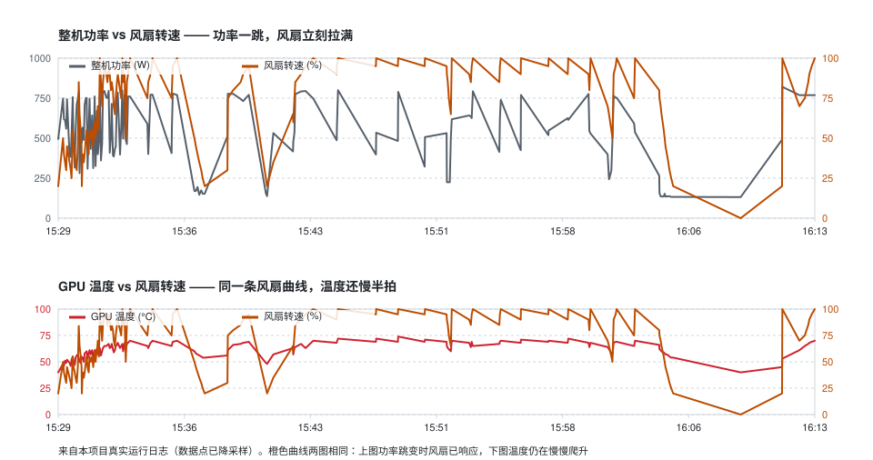

# mijia-thermal-bridge

**Keep your local-LLM GPUs cool with a ¥99 Xiaomi desk fan — fully automated, LAN-only, no cloud.**

*([中文文档](README.zh-CN.md))*

```
nvidia-smi ──> GPU temp / power draw ─┐
                                      ├──> control law ──> Xiaomi fan 0-100%
Mijia smart plug ──> wall power (W) ──┘
```

Running local models (dual RTX 3080 20G: ~500 W of GPU, ~800 W at the wall) cooks the
cards to 73-78 °C and the case fans can't keep up. An external circulator fan pointed at
the GPUs works — but nobody wants to flip it on and off by hand.

So it follows the temperature automatically.

**Talks raw miIO over the LAN.** No Mijia cloud round-trip, no Home Assistant, no
MQTT broker, no port forwarding. One Python file, one `config.json`.




*Two panels, same orange fan curve. Top: the moment wall power jumps, the fan is already
at full speed. Bottom: GPU temperature is still climbing — 30-60 s of thermal lag too late
to catch the spike. That gap is the whole point of this project.*

## Why power feed-forward

GPU temperature has 30-60 s of thermal inertia. If you wait for the temperature to rise
before speeding up the fan, the spike has already happened.

Wall power jumps within 1-2 s of a load starting — **5-10 s ahead of temperature**. So the
control law takes the maximum of both signals and lets power lead:

```
target% = max( temp term (T-50)/(70-50) , power term (P-700)/(800-700) ) × 100
```

## Control law

| Behaviour | Rule |
|---|---|
| **Ramp up** | **Instant.** Asymmetric EMA, τ = 1 s. No waiting, no smoothing of danger |
| **Ramp down** | Requires *sustained* cool for `drop_delay_seconds` (180 s), otherwise frozen at the high value |
| **Quantisation** | 5 % steps + 2 s minimum interval between commands — don't spam the fan firmware |
| **Floor** | 20 % whenever not idle — the fan never stalls while the box is awake |
| **Idle stop** | Wall < 200 W **and** GPU < 45 °C for 600 s → switch the fan off |
| **Wake** | Wall > 240 W **or** GPU ≥ 48 °C (40 W hysteresis band, no flapping) |
| **Fail-safe** | `nvidia-smi` unreadable 3× in a row → force 100 % (loud beats dead) |

Biasing hard toward cooling is deliberate: this is for a headless box in a back room.
Noise and motor wear are explicitly *not* optimised for. If you want that, raise
`ema_down_seconds` and lower `max_speed`.

## Install

Python 3.11+ (tested on 3.13) and a machine with `nvidia-smi`.

```bash
git clone https://github.com/PiccataPro/mijia-thermal-bridge.git
cd mijia-thermal-bridge
python -m venv .venv
.venv\Scripts\activate     # Windows
source .venv/bin/activate  # Linux / macOS
pip install -r requirements.txt
```

<details>
<summary><b>If <code>pip install</code> fails building <code>netifaces</code></summary>

`python-miio 0.5.12` is unmaintained and pins `netifaces`, which ships **no wheels** — it
must compile from source. On Python 3.12 and below there are prebuilt wheels / it compiles
fine. On **3.13 the build fails** unless you happen to have MSVC + the Windows SDK installed.

`netifaces` is only imported by python-miio's firmware-update module, which this project
never touches — so skip it:

```bash
pip install --no-deps python-miio==0.5.12
pip install micloud requests click construct cryptography defusedxml attrs appdirs croniter pytz PyYAML tqdm zeroconf
```

Verified working on 3.13 (`from miio import MiotDevice` succeeds; pip will print two
"requires netifaces / android_backup" warnings — they are harmless here).

</details>

<details>
<summary><b>If you get <code>Unable to discover device</b></summary>

miIO uses **UDP 54321**. On Windows, firewall rules match on the executable's *path*, so a
venv copied or relocated from elsewhere can be silently blocked — replies are dropped and
it looks like the device is dead. Create a fresh venv in place, or allow that `python.exe`.

Also: the machine running this must be on the **same L2 subnet** as the devices. A VLAN or
a guest Wi-Fi isolation will not work.

</details>

## Get device tokens

LAN miIO control needs a per-device **token** — a 32-hex-char AES key the Mijia app never
shows you. `get_tokens.py` uses a browser-login + script-exchange flow, so **you never hand
your Xiaomi password to a script**:

```bash
python get_tokens.py --print-login-url
```

Open the printed URL in a browser that is already signed in to your Xiaomi account. After
login the page shows something like:

```
&&&START&&&{"location":"https://sts.api.io.mi.com/sts?...","userId":...}&&&END&&&
```

Save that whole blob to `location.json`, then:

```bash
python get_tokens.py location.json
```

You get `name / model / did / token / localip` for every device.

- `location` is short-lived — run the script right after copying it.
- If login demands verification, complete it in the browser, then copy again.
- **A token is a device control key.** `config.json` is git-ignored; keep it that way.

*Prefer not to script the login at all?* [Xiaomi Cloud Tokens Extractor](https://github.com/PiotrMachowski/Xiaomi-cloud-tokens-extractor)
is the standard tool and works fine here too.

## Find your siid / piid

MIoT property IDs differ per model. Scan yours:

```bash
python map_props.py --ip 192.168.1.52 --token <your-token>
```

Put the `[siid, piid]` pairs you need into `config.json` under `devices.*.props`.

Verified on these models (safe to copy):

| Device | model | Key properties |
|---|---|---|
| Xiaomi Smart Power Plug 4 | `xiaomi.plug.04` | switch `2.1`; **instant power `11.1` (float, W)** |
| Mi Air Purifier 4 Pro2 | `xiaomi.airp.va2b` | switch `2.1`, mode `2.4`, fan level `2.5`, PM2.5 `3.4` |
| Mi Smart Circulator Fan | `xiaomi.fan.p69` | switch `2.1`, **speed `2.5` (1-100, writable)**, mode `2.4` |

> **Trap 1 — the fake power property.** On the plug, `siid3.piid2` *looks* like power but is
> the **rated** max (always 1320). Tell them apart by sampling for 30 s: real instant power
> swings with load, a rating is a flat line.
>
> **Trap 2 — the wrapper methods lie.** You must call
> `md.send("get_properties", [{"did":"x","siid":s,"piid":p}])`. python-miio's own
> `get_properties()` wrapper returns `undefined command` on some firmwares. Going through
> the raw protocol works everywhere.

## Run it

```bash
cp config.example.json config.json   # fill in ip / token
python thermal_link.py --once        # single pass, DRY-RUN by default — prints, touches nothing
python thermal_link.py --loop --live # foreground, real control, Ctrl-C to stop
```

`thermal_link.enabled` in `config.json` is a **hard switch**: while it is `false`, no
command-line flag can enable real control. `dry_run: true` logs without acting.
Once you trust it, set `enabled: true, dry_run: false`.

Built-in PID-file lock — starting a second instance exits immediately.

**Windows:** `start_thermal_link.vbs` launches silently with no console window; drop a
shortcut into `shell:startup` for autostart.

**Linux:**

```ini
# /etc/systemd/system/mijia-thermal-bridge.service
[Service]
ExecStart=/opt/mijia-thermal-bridge/.venv/bin/python /opt/mijia-thermal-bridge/thermal_link.py --loop
Restart=always
```

## Power logging (optional)

`collector.py` logs wall power plus per-GPU temperatures into SQLite, so you can *measure*
before picking thresholds:

```bash
python collector.py --loop --interval 2
python collector.py --report     # cumulative kWh / mean / peak
```

Run it for a day, get your box's idle and load distribution, then set `power_start_w` /
`power_full_w`. Measured on this box: idle ~130 W, dual-GPU inference ~780 W, peak ~970 W.

## Tests

Control-law timeline simulation. Touches no device, needs no GPU:

```bash
python test_hold.py
```

An 1115 s timeline (idle → spike → partial dip → second spike → long cool → fully idle)
asserting three things: every ramp-up is instant; every intermediate ramp-down happens only
in the "long cool" phase and after the full 180 s; the fan stops only after a full 600 s
of complete idle.

## Measured results

| Scenario | GPU | Wall | Fan |
|---|---|---|---|
| Idle | 32-45 °C | 130-190 W | 20 % → off after 10 min |
| Inference starts | 53 °C (rising) | 730 W | 30 % — power term already leading, temp hasn't moved |
| Full load | 70 °C | 780 W | 100 % |
| Load ends | 61 °C | 570 W | held high, starts falling only after 180 s |

Dual-GPU full load: **78 °C → 73-75 °C**.

## Honest notes

1. **The control law is not your bottleneck — airflow is.** An open side panel destroys the
   case's airflow path; refitting the mesh panel beats any algorithm. An external fan 5-10 cm
   from the case creates a negative-pressure zone at the intake; back it off 25-30 cm and
   angle it 10-15° rearward.
2. **The real fix is a power limit.** `nvidia-smi -pl 260` (320 → 260 W) costs 3-5 % of
   throughput and drops temperatures 5-8 °C — more than any fan curve. The fan is a
   mitigation, not a substitute.
3. **The air purifier is deliberately not in the loop.** Its outlet can't be aimed at the
   case, so it does nothing for GPU temperature. Left on `auto` for dust. The
   `purifier_role` field exists but defaults to `off`.
4. **Never put your own box on the controlled plug.** This project only ever *reads* the
   plug. It has no code path that writes the plug's switch, by design.

## Compatibility

Tested on `xiaomi.fan.p69` + `xiaomi.plug.04`. Other models: scan with `map_props.py` and
confirm the speed property is writable. In principle anything with LAN miIO support works.

## License

MIT
