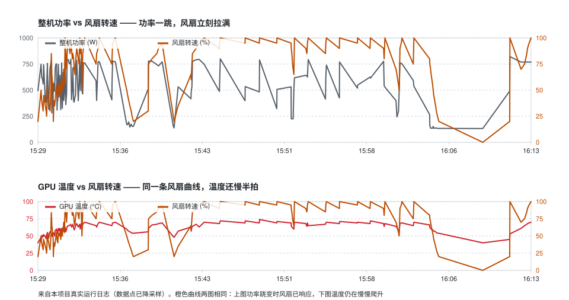

# mijia-thermal-bridge

用一台**米家循环扇**给跑本地大模型的显卡做物理降温：读取 GPU 温度 + 插座整机功率，
实时调节风扇转速，空闲时自动停转。全程走**局域网 miIO 协议**，不依赖米家云端、不需要 Home Assistant。

*（[English documentation](README.md)）*

```
nvidia-smi ──> GPU 温度/功耗 ─┐
                              ├──> 控制律 ──> 米家循环扇 0-100%
米家插座 ──> 整机瞬时功率 ────┘
```



*两个面板画的是同一条橙色风扇曲线。上图：整机功率一跳，风扇已经拉满。
下图：GPU 温度还在往上爬——30-60s 的热惯性，等它上来早就错过了。
这个时间差就是本项目存在的全部理由。*

## 为什么要做这个

本地推理（双卡 3080 20G 满载 ~500W GPU / 整机 ~800W）时，机箱自带风道压不住，
显卡长期 73-78°C。加一台外置循环扇直吹效果显著，但人肉开关不现实——
于是让它跟着温度自动变速。

关键设计是**用插座功率做前馈**：GPU 温度有 30-60s 热惯性，等温度上来再拉风量已经晚了；
整机功率在负载起来后 1-2s 就跳变，比温度早 5-10s，用它提前拉满风量。

## 控制律

```
目标% = max( 温度项 (T-50)/(70-50) , 功率项 (P-700)/(800-700) ) × 100
```

| 行为 | 说明 |
|---|---|
| 升速 | **立即**，非对称 EMA τ=1s，任何等待都不加 |
| 降速 | 必须"彻底低温"持续 `drop_delay_seconds`(180s) 才允许，否则冻结在高位 |
| 量化 | 5% 一档 + 最小下发间隔 2s，避免刷指令打爆风扇固件 |
| 常转下限 | 非空闲时最低 20%，风扇不停 |
| 空闲停转 | 整机 <200W **且** GPU <45°C 持续 600s → 关开关停转 |
| 唤醒 | 整机 >240W **或** GPU ≥48°C（40W 迟滞带，防抖） |
| 故障保护 | `nvidia-smi` 连续 3 次读不到 → 强制 100%（宁可吵死不要热死） |

就高不就低是刻意的：降温优先，不考虑噪音和电机磨损。

## 安装

需要 Python 3.11+（本机实测 3.13）与 `nvidia-smi`。

```bash
python -m venv .venv
# Windows
.venv\Scripts\pip install -r requirements.txt
# Linux/macOS
source .venv/bin/activate && pip install -r requirements.txt
```

> ⚠️ Windows 上如果 Python 装在其他盘或从别处复制过来的 venv，可能被防火墙规则按
> 可执行路径拦截 UDP 54321，表现为 `Unable to discover device`。
> 换一个新目录建 venv 或放行该 python.exe 即可。

## 取设备 token

局域网 miIO 控制需要设备 token（32 位 hex，即 AES 密钥），米家 App 不显示。
`get_tokens.py` 走"浏览器登录 + 脚本换 token"，**不需要把账号密码交给脚本**：

```bash
python get_tokens.py --print-login-url
```

用已登录小米账号的浏览器打开打印出的地址，登录后页面会显示一段
`&&&START&&&{"location":"https://sts.api.io.mi.com/sts?..."}&&&END&&&`，
整段复制存成 `location.json`，然后：

```bash
python get_tokens.py location.json
```

输出每台设备的 `name / model / did / token / localip`。
`location` 有时效，取到后尽快执行。若登录提示需要验证，在浏览器里完成验证再复制。

**token 等同设备控制密钥，`config.json` 已在 .gitignore 里，不要提交。**

## 确认 siid/piid

不同型号的 MIoT 属性编号不一样，先扫一遍：

```bash
python map_props.py --ip 192.168.1.52 --token <你的token>
```

把确认要用的 `[siid, piid]` 填进 `config.json` 的 `devices.*.props`。

本机实测（可直接抄的型号）：

| 设备 | model | 关键属性 |
|---|---|---|
| 小米智能插座4 | `xiaomi.plug.04` | 开关 `2.1`；**瞬时功率 `11.1`（float, W）** |
| 米家空气净化器 4 Pro2 | `xiaomi.airp.va2b` | 开关 `2.1`、模式 `2.4`、档位 `2.5`、PM2.5 `3.4` |
| 米家直流变频台式循环扇 | `xiaomi.fan.p69` | 开关 `2.1`、**速度 `2.5`（1-100，可写）**、模式 `2.4` |

> 坑 1：插座 `siid3.piid2` 看着像功率，实际是**额定功率**（恒为 1320），不可用。
> 判断办法是采样 30s 看波动幅度——真瞬时功率会随负载跳变。
>
> 坑 2：调用必须用 `md.send("get_properties", [{"did":"x","siid":s,"piid":p}])`。
> python-miio 的包装方法在部分固件上返回 `undefined command`，走底层协议才稳。

## 跑起来

```bash
copy config.example.json config.json   # 填 ip/token
python thermal_link.py --once          # 单轮，默认 DRY-RUN 只打印不动设备
python thermal_link.py --loop --live   # 前台真控，Ctrl-C 退出
```

`config.json` 里 `thermal_link.enabled` 是**硬开关**：`false` 时任何命令行参数都开不了真控。
`dry_run: true` 时只记录不下发。确认没问题再设 `enabled: true, dry_run: false`。

常驻（Windows）：`start_thermal_link.vbs` 静默启动、无黑窗，拷进
`shell:startup` 即开机自启。Linux 用 systemd unit：

```ini
[Service]
ExecStart=/path/to/.venv/bin/python /path/to/thermal_link.py --loop
Restart=always
```

带 PID 文件单实例锁，重复启动会直接退出。

## 功率采集（可选）

`collector.py` 独立采集插座功率 + 双卡温度落 SQLite，用于定阈值：

```bash
python collector.py --loop --interval 2
python collector.py --report     # 累计 kWh / 均值 / 峰值
```

先跑一天拿到自己机器的空载/满载功率分布，再回来定 `power_start_w` / `power_full_w`。
本机实测：空载 ~130W，双卡推理 ~780W，峰值 ~970W。

## 测试

控制律的时间轴仿真，不碰真实设备：

```bash
python test_hold.py
```

1115s 时间轴（待机→突发→回落→再来一波→长时间低温→完全空闲），
断言三件事：升速全部立即、中间降速只发生在"长时间彻底低温"且等满 180s、
停转发生在完全空闲满 600s 之后。

## 实测效果

| 场景 | GPU | 整机 | 风扇 |
|---|---|---|---|
| 空载 | 32-45°C | 130-190W | 20% → 10min 后停转 |
| 推理突发 | 53°C（上升中） | 730W | 30%（功率项已顶到 30%，温度还没动） |
| 满载 | 70°C | 780W | 100% |
| 负载结束 | 61°C | 570W | 保持高位，180s 后才开始降 |

双卡满载从 78°C 压到 73-75°C。

## 几条实话

1. **控制律不是瓶颈，结构才是。** 侧板敞开等于风道报废，装回网孔侧板比任何调速算法都有效；
   外置扇距机箱 5-10cm 会在进风口形成负压区，后撤 25-30cm 朝后偏 10-15° 才有用。
2. **根本解法是功耗墙。** `nvidia-smi -pl 260`（320→260W）性能只掉 3-5%，温度直接降 5-8°C，
   比风扇管用。风扇是补救，不是替代。
3. **净化器不参与联动。** 出风口对不准机箱，对显卡降温无实效，让它 auto 常开除尘就好。
   代码里保留了 `purifier_role` 字段但默认 `off`。
4. **别用受控插座给本机供电。** 本项目永不写插座开关，只读功率。

## 支持范围

只在 `xiaomi.fan.p69` + `xiaomi.plug.04` 上实测过。其他型号需要自己用
`map_props.py` 扫属性、确认速度属性可写。理论上任何支持 miIO 局域网控制的米家设备都能接。

## License

MIT
